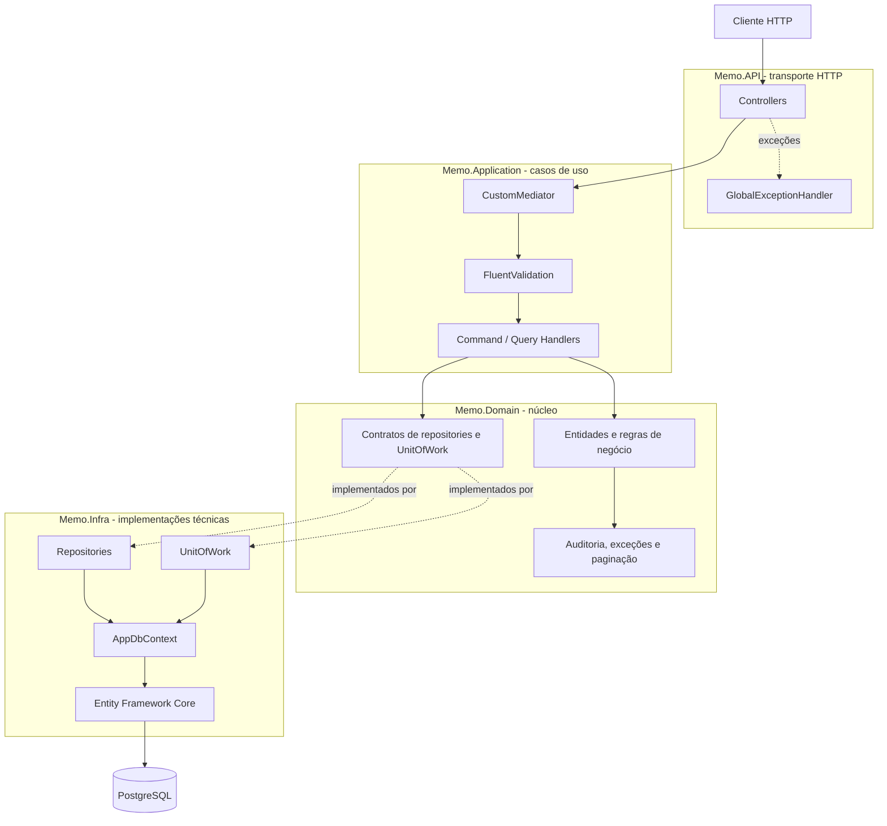

# Arquitetura do Memo.API

## Visão geral

O Memo.API utiliza **Clean Architecture**, organizadando em camadas e casos de uso, 
incorporando princípios de **Domain-Driven Design (DDD)** e o padrão **CQRS (Command Query 
Responsibility Segregation)**.

A arquitetura promove a separação de responsabilidades e o isolamento das regras de negócio 
em relação aos detalhes técnicos da aplicação. 
Para isso, o projeto é dividido em quatro camadas principais:

- **Domain:** núcleo da aplicação, responsável pelas entidades, regras de negócio, 
invariantes e contratos de abstração, como repositories e UnitOfWork.

- **Application:** responsável pela orquestração dos casos de uso, contendo Commands, 
Queries, Handlers, validações e modelos de resposta.

- **Infrastructure:** responsável pelas implementações técnicas, incluindo persistência,
Entity Framework Core, repositories, UnitOfWork e serviços de infraestrutura.

- **API:** camada de entrada e comunicação HTTP, responsável pelos controllers, 
configuração da aplicação, middlewares e tratamento global de exceções.

### Diagrama da arquitetura



O fluxo principal percorre a API, a Application e as abstrações do Domain até
as implementações da Infra e o PostgreSQL. As setas pontilhadas representam
inversão de dependência: os contratos são definidos no Domain, mas suas
implementações ficam na Infra.

### Regra de dependência

As dependências apontam para dentro: a **API** usa a **Application**, a **Application**
usa abstrações definidas no **Domain**, e a **Infra** implementa essas abstrações.
O Domain não depende das camadas externas. Com isso, as regras de negócio ficam independentes 
do banco de dados e do framework HTTP, os casos de uso podem ser testados de forma isolada e 
detalhes técnicos podem ser trocados sem alterar o núcleo.

### CQRS

O CQRS organiza as operações da aplicação em dois tipos de requisição: Commands, responsáveis por 
alterar o estado do sistema, e Queries, responsáveis exclusivamente pela consulta de informações. 
Um Mediator próprio (`CustomMediator`) realiza o encaminhamento dessas requisições para seus respectivos Handlers, 
centralizando o fluxo de execução e a validação dos requests.

### DDD

Os princípios de DDD são aplicados principalmente na modelagem do domínio, 
por meio de entidades que encapsulam regras de negócio, protegem suas invariantes e 
controlam as alterações de estado. O projeto também utiliza abstrações de repositórios 
para separar o domínio dos mecanismos de persistência.

O projeto utiliza:

- **.NET 10** e ASP.NET Core;
- **PostgreSQL** com Entity Framework Core;
- **CQRS** para separar comandos e consultas;
- um **Mediator próprio** para executar handlers;
- **FluentValidation** para validar requests;
- entidades auditáveis com **soft-delete**;
- paginação reutilizável;
- `CancellationToken` propagado da requisição HTTP até o EF Core;
- testes separados por camada.

## Estrutura da solução

```text
Memo.API.sln
├── Memo.API
├── Memo.Application
├── Memo.Domain
├── Memo.Infra
```

### Memo.Domain

É o núcleo do sistema. Contém regras e abstrações que não dependem de
ASP.NET Core, Entity Framework ou banco de dados.

Responsabilidades:

- entidades e regras de negócio;
- exceções de domínio;
- contratos de repositories;
- contratos de `IUnitOfWork` e contexto do usuário;
- classes comuns, como auditoria e paginação.

Principais diretórios:

```text
Memo.Domain/
├── Common/
├── Entities/
├── Exceptions/
└── IRepositories/
```

Uma entidade persistida segue o padrão de `AuditableEntity`. Isso fornece:

- `Id`;
- `CreatedAt` e `CreatedBy`;
- `UpdatedAt` e `UpdatedBy`;
- `IsDeleted`;
- `DeletedAt` e `DeletedBy`.

As propriedades têm setters protegidos, e as alterações devem ser feitas por
métodos da própria entidade, como `Update`.

### Memo.Application

Implementa os casos de uso da aplicação. Essa camada coordena validação,
regras de fluxo, repositories e persistência, mas não conhece detalhes do
PostgreSQL.

Cada feature é organizada por entidade e operação:

```text
Features/
└── Companies/
    ├── Commands/
    │   ├── Create/
    │   ├── Update/
    │   └── Delete/
    ├── Queries/
        ├── GetAll/
        ├── GetById/
        └── Response/
```

Cada operação normalmente possui:

- um `record` que representa o request;
- um `Validator`;
- um `Handler`;
- uma resposta específica, quando necessário.

Comandos alteram estado (`Create`, `Update`, `Delete`). Queries apenas
consultam dados (`GetAll`, `GetById`).

### Memo.Infra

Implementa os detalhes técnicos da aplicação:

- `AppDbContext`;
- configurações do Entity Framework;
- repositories concretos;
- `UnitOfWork`;
- paginação;
- migrations;
- contexto do usuário.

Principais diretórios:

```text
Memo.Infra/
├── Migrations/
├── Persistence/
│   └── Configuration/
├── Repositories/
└── Services/
```

O `AppDbContext` aplica automaticamente as configurações encontradas no
assembly e cria filtros globais para não retornar entidades com
`IsDeleted = true`.

Exclusões são convertidas em alterações durante `SaveChangesAsync`: o registro
não é removido fisicamente; ele recebe os dados de soft-delete.

### Memo.API

É a camada de transporte HTTP. Contém:

- controllers;
- configuração da aplicação;
- tratamento global de exceções;
- Swagger/OpenAPI;
- configuração de middleware.

Controllers não devem conter regras de negócio. Eles recebem a requisição,
montam ou recebem o command/query, encaminham para o mediator e transformam o
resultado em resposta HTTP.

## Fluxo de uma requisição

O fluxo normal é:

```text
HTTP request
    ↓
Controller
    ↓
IMediator.SendAsync(request, ct)
    ↓
Validator
    ↓
IRequestHandler.HandleAsync(request, ct)
    ↓
Repository / UnitOfWork
    ↓
Entity Framework Core
    ↓
PostgreSQL
```

O `CustomMediator` localiza o validator e o handler pelo tipo do request.
Quando a validação falha, ele lança `FluentValidation.ValidationException`.
Quando não existe handler registrado, lança uma exceção explícita.

O `GlobalExceptionHandler` converte as exceções conhecidas em respostas
`ProblemDetails`, incluindo erros de validação, regras de domínio, entidade
não encontrada e violação de unicidade.

## CancellationToken

O controller é a entrada do token associado à requisição HTTP. Os endpoints
podem declarar `CancellationToken ct = default` e devem passá-lo ao mediator.

Nas camadas internas, o token é obrigatório:

```text
Controller: ct = default
Mediator: ct
Handler: ct
Repository: ct
Pagination service: ct
UnitOfWork: ct
EF Core: ct
```

Operações assíncronas que acessam o banco devem usar o token:

```csharp
await query.CountAsync(ct);
await query.ToListAsync(ct);
await context.SaveChangesAsync(ct);
```

Chamadas síncronas como `Add`, `Update` e `Delete` apenas alteram o
`DbContext` em memória. A operação de banco ocorre no `SaveChangesAsync(ct)`.

## Padrão dos endpoints

Os controllers seguem convenções REST:

| Operação | Rota | Resposta esperada |
|---|---|---|
| Listar | `GET /api/companies` | `200 OK` |
| Buscar por ID | `GET /api/companies/{id}` | `200 OK` ou `404 Not Found` |
| Criar | `POST /api/companies` | `201 Created` |
| Atualizar | `PUT /api/companies/{id}` | `204 No Content` |
| Excluir logicamente | `DELETE /api/companies/{id}` | `204 No Content` |

O mesmo padrão é usado para `Seller`.

O `POST` retorna `CreatedAtAction`, apontando para o endpoint de busca por ID.
No `PUT`, o ID da rota prevalece sobre qualquer ID enviado no body:

```csharp
await mediator.SendAsync(command with { Id = id }, ct);
```

## Validação, auditoria e unicidade

A validação ocorre em dois níveis:

1. **FluentValidation**, para validar a entrada da aplicação;
2. **domínio**, para preservar invariantes mesmo quando a entidade é criada
   fora da API.

A entidade `Company`, por exemplo, garante que:

- o nome não seja vazio;
- a comissão esteja entre `0` e `100`.

Índices únicos de entidades com soft-delete devem considerar somente registros
ativos. Por exemplo:

```csharp
builder.HasIndex(company => company.Name)
    .IsUnique()
    .HasFilter("\"IsDeleted\" = false");
```

Assim, nomes podem ser reutilizados depois de uma exclusão lógica, mas
continuam únicos entre registros ativos.

## Como criar uma nova entidade

O exemplo abaixo usa uma entidade hipotética chamada `Product`. Adapte os
nomes e regras ao domínio real.

### 1. Criar a entidade no Domain

Crie `Memo.Domain/Entities/Product.cs`.

```csharp
using Memo.Domain.Common;
using Memo.Domain.Exceptions;

namespace Memo.Domain.Entities;

public sealed class Product : AuditableEntity
{
    public string Name { get; private set; } = null!;
    public decimal Price { get; private set; }

    private Product()
    {
    }

    public Product(string name, decimal price)
    {
        Validate(name, price);
        Name = name;
        Price = price;
    }

    public void Update(string name, decimal price)
    {
        Validate(name, price);
        Name = name;
        Price = price;
    }

    private static void Validate(string name, decimal price)
    {
        if (string.IsNullOrWhiteSpace(name))
            throw new DomainException("Product name cannot be null or empty.");

        if (price < 0)
            throw new DomainException("Price cannot be negative.");
    }
}
```

O construtor sem parâmetros deve permanecer privado para o EF Core. A
inicialização `= null!` evita o warning de nulabilidade causado por esse
construtor.

### 2. Criar o contrato do repository

Crie `Memo.Domain/IRepositories/IProductRepository.cs`.

```csharp
using Memo.Domain.Common;
using Memo.Domain.Entities;

namespace Memo.Domain.IRepositories;

public interface IProductRepository
{
    Task<PagedList<Product>> GetPagedAsync(int page, int pageSize, CancellationToken ct);
    Task<Product?> GetByIdAsync(Guid id, CancellationToken ct);
    Product Add(Product product);
    Product Update(Product product);
    Product Delete(Product product);
}
```

Repositories devem exigir `CancellationToken`; apenas os controllers são a
fronteira que pode fornecer `= default`.

### 3. Adicionar a configuração do EF Core

Crie `Memo.Infra/Persistence/Configuration/ProductConfiguration.cs`.

```csharp
using Memo.Domain.Entities;
using Microsoft.EntityFrameworkCore;
using Microsoft.EntityFrameworkCore.Metadata.Builders;

namespace Memo.Infra.Persistence.Configuration;

internal sealed class ProductConfiguration : IEntityTypeConfiguration<Product>
{
    public void Configure(EntityTypeBuilder<Product> builder)
    {
        builder.ToTable("Products");
        builder.HasKey(product => product.Id);
        builder.Property(product => product.Name).IsRequired().HasMaxLength(100);
        builder.HasIndex(product => product.Name).IsUnique().HasFilter(""" "IsDeleted" = false""");
        builder.Property(product => product.Price).IsRequired().HasPrecision(12, 2);
    }
}
```

Como o `AppDbContext` usa `ApplyConfigurationsFromAssembly`, a configuração
será descoberta automaticamente.

### 4. Registrar o DbSet

Em `Memo.Infra/Persistence/AppDbContext.cs`, adicione:

```csharp
public DbSet<Product> Products => Set<Product>();
```

O filtro global de soft-delete e o processamento de auditoria já são aplicados
automaticamente por `AppDbContext`, pois `Product` herda de `AuditableEntity`.

### 5. Implementar o repository

Crie `Memo.Infra/Repositories/ProductRepository.cs`.

```csharp
using Memo.Domain.Common;
using Memo.Domain.Entities;
using Memo.Domain.IRepositories;
using Memo.Infra.Persistence;
using Memo.Infra.Services;
using Microsoft.EntityFrameworkCore;

namespace Memo.Infra.Repositories;

internal sealed class ProductRepository(AppDbContext context, IPaginationService pagination) : IProductRepository
{
    public async Task<PagedList<Product>> GetPagedAsync(int page, int pageSize, CancellationToken ct)
    {
        IQueryable<Product> query = context.Products
            .AsNoTracking()
            .OrderBy(product => product.CreatedAt)
            .ThenBy(product => product.Id);

        return await pagination.PaginateAsync(query, page, pageSize, ct);
    }

    public async Task<Product?> GetByIdAsync(Guid id, CancellationToken ct)
    {
        return await context.Products
            .FirstOrDefaultAsync(product => product.Id == id, ct);
    }

    public Product Add(Product product)
    {
        context.Products.Add(product);
        return product;
    }

    public Product Update(Product product)
    {
        context.Products.Update(product);
        return product;
    }

    public Product Delete(Product product)
    {
        context.Products.Remove(product);
        return product;
    }
}
```

### 6. Registrar a implementação no DI

Em `Memo.Infra/DependencyInjection.cs`:

```csharp
services.AddScoped<IProductRepository, ProductRepository>();
```

Sem esse registro, o mediator encontrará o handler, mas a injeção do
repository falhará em runtime.

### 7. Criar responses, commands, queries, validators e handlers

Crie uma pasta `Memo.Application/Features/Products` com a mesma organização
usada por `Companies`:

```text
Products/
├── Commands/
│   ├── Create/
│   ├── Update/
│   └── Delete/
├── Queries/
│   ├── GetAll/
│   └── GetById/
└── Response/
```

O fluxo de desenvolvimento de cada operação é:

```text
Response (se precisar)
    ↓
Command ou Query
    ↓
Validator (se precisar)
    ↓
CommandHandler ou QueryHandler
```

#### Response

Crie o response antes da query quando a operação retornar dados. Responses
representam o contrato de saída da aplicação e evitam expor entidades do
domínio diretamente pela API:

```csharp
namespace Memo.Application.Features.Products.Response;

public sealed record ProductResponse(Guid Id, string Name, decimal Price);
```

Commands que apenas executam uma ação podem retornar `Guid`, `bool` ou outro
tipo simples, conforme o contrato da operação. Não é necessário criar um
response para toda operação.

#### Command e CommandHandler

Um command representa uma intenção que altera o estado. Por exemplo,
`CreateProductCommand` recebe somente os dados necessários para criar o
produto:

```csharp
using Memo.Application.Common.CQRS;

namespace Memo.Application.Features.Products.Commands.Create;

public sealed record CreateProductCommand(string Name, decimal Price) : IRequest<Guid>;
```

O handler recebe as dependências por injeção, cria a entidade, adiciona-a ao
repository e confirma a transação pela unit of work:

```csharp
using Memo.Application.Common.CQRS;
using Memo.Domain.Common;
using Memo.Domain.Entities;
using Memo.Domain.IRepositories;

namespace Memo.Application.Features.Products.Commands.Create;

internal sealed class CreateProductCommandHandler(
    IProductRepository repository,
    IUnitOfWork unitOfWork)
    : IRequestHandler<CreateProductCommand, Guid>
{
    public async Task<Guid> HandleAsync(
        CreateProductCommand request,
        CancellationToken ct)
    {
        Product product = new(request.Name, request.Price);

        repository.Add(product);
        await unitOfWork.SaveChangesAsync(ct);

        return product.Id;
    }
}
```

Para update, o handler deve buscar a entidade, lançar
`EntityNotFoundException<Product>` quando ela não existir, chamar o método de
domínio de atualização e salvar as alterações. Para delete, deve buscar a
entidade e chamar `repository.Delete`; o `AppDbContext` transforma essa
remoção em soft-delete.

#### Query e QueryHandler

Uma query apenas consulta dados e não chama `SaveChangesAsync`. Por exemplo,
uma query paginada retorna `PagedList<ProductResponse>`:

```csharp
using Memo.Application.Common.CQRS;
using Memo.Application.Features.Products.Response;
using Memo.Domain.Common;

namespace Memo.Application.Features.Products.Queries.GetAll;

public sealed record GetAllProductsQuery(int Page, int PageSize) : IRequest<PagedList<ProductResponse>>;
```

O query handler consulta o repository e mapeia a entidade para o response:

```csharp
using Memo.Application.Common.CQRS;
using Memo.Application.Features.Products.Response;
using Memo.Domain.Common;
using Memo.Domain.Entities;
using Memo.Domain.IRepositories;

namespace Memo.Application.Features.Products.Queries.GetAll;

internal sealed class GetAllProductsQueryHandler(IProductRepository repository)
    : IRequestHandler<GetAllProductsQuery, PagedList<ProductResponse>>
{
    public async Task<PagedList<ProductResponse>> HandleAsync(GetAllProductsQuery request, CancellationToken ct)
    {
        PagedList<Product> pagedList = await repository.GetPagedAsync(
            request.Page,
            request.PageSize,
            ct);

        IReadOnlyList<ProductResponse> products = pagedList.Items
            .Select(product => new ProductResponse(
                product.Id,
                product.Name,
                product.Price))
            .ToList();

        return new PagedList<ProductResponse>(
            products,
            pagedList.Page,
            pagedList.PageSize,
            pagedList.TotalItems);
    }
}
```

Para uma query por ID, crie `GetProductByIdQuery(Guid Id) :
IRequest<ProductResponse>` e um `GetProductByIdQueryHandler`. O handler deve
buscar pelo repository, lançar `EntityNotFoundException<Product>` se o
resultado for nulo e mapear o produto para `ProductResponse`.

Cada request deve implementar `IRequest<TResponse>`. Cada handler deve:

- receber o repository por injeção;
- receber `CancellationToken ct` sem valor padrão;
- passar `ct` para todas as operações assíncronas;
- lançar `EntityNotFoundException<Product>` quando necessário;
- chamar `SaveChangesAsync(ct)` somente em comandos que alteram dados.

Não é necessário registrar handlers manualmente. O `AddApplication` faz
scan do assembly e registra automaticamente implementações de
`IRequestHandler<,>`.

#### Validator

Crie um validator somente quando o command ou query tiver regras de entrada.
Ele deve ser interno, derivar de `AbstractValidator<T>` e ficar junto da
operação:

Exemplo:

```csharp
internal sealed class CreateProductValidator : AbstractValidator<CreateProductCommand>
{
    public CreateProductValidator()
    {
        RuleFor(product => product.Name)
            .NotEmpty().WithMessage("Name is required.")
            .MaximumLength(100).WithMessage("Name must not exceed 100 characters.");

        RuleFor(product => product.Price)
            .GreaterThanOrEqualTo(0).WithMessage("Price must be greater than or equal to zero.");
    }
}
```

Os validators são descobertos automaticamente por
`AddValidatorsFromAssembly(..., includeInternalTypes: true)`.

### 10. Criar o controller

Crie `Memo.API/Controllers/ProductsController.cs`, seguindo o padrão de
`CompaniesController`.

O controller é apenas a camada HTTP: recebe parâmetros da rota/query/body,
cria o command ou query, envia-o ao mediator e converte o resultado em
resposta HTTP. Ele não deve conter regra de negócio nem acessar o repository
diretamente.

Implemente os endpoints CRUD da seguinte forma:

```csharp
using Memo.Application.Common.CQRS;
using Memo.Application.Features.Products.Commands.Create;
using Memo.Application.Features.Products.Commands.Delete;
using Memo.Application.Features.Products.Commands.Update;
using Memo.Application.Features.Products.Queries.GetAll;
using Memo.Application.Features.Products.Queries.GetById;
using Microsoft.AspNetCore.Mvc;

namespace Memo.API.Controllers;

[ApiController]
[Route("api/products")]
public sealed class ProductsController(IMediator mediator) : ControllerBase
{
    [HttpGet]
    [EndpointSummary("Listar produtos paginado")]
    [EndpointDescription("Retorna uma lista paginada de produtos ativos.")]
    public async Task<IActionResult> GetAll(
        [FromQuery] int page = 1,
        [FromQuery] int pageSize = 10,
        CancellationToken ct = default)
    {
        var result = await mediator.SendAsync(new GetAllProductsQuery(page, pageSize), ct);
        return Ok(result);
    }

    [HttpGet("{id:guid}")]
    [EndpointSummary("Buscar produto por ID")]
    [EndpointDescription("Retorna os dados de um produto específico.")]
    public async Task<IActionResult> GetById(Guid id, CancellationToken ct = default)
    {
        var result = await mediator.SendAsync(new GetProductByIdQuery(id), ct);
        return Ok(result);
    }

    [HttpPost]
    [EndpointSummary("Criar produto")]
    [EndpointDescription("Cria um produto novo e retorna o seu ID.")]
    public async Task<IActionResult> Create(
        [FromBody] CreateProductCommand command,
        CancellationToken ct = default)
    {
        Guid id = await mediator.SendAsync(command, ct);
        return CreatedAtAction(nameof(GetById), new { id }, id);
    }

    [HttpPut("{id:guid}")]
    [EndpointSummary("Alterar produto")]
    [EndpointDescription("Edita os dados de um produto específico.")]
    public async Task<IActionResult> Update(
        Guid id,
        [FromBody] UpdateProductCommand command,
        CancellationToken ct = default)
    {
        await mediator.SendAsync(command with { Id = id }, ct);
        return NoContent();
    }

    [HttpDelete("{id:guid}")]
    [EndpointSummary("Deletar produto")]
    [EndpointDescription("Exclui logicamente (soft-delete) um produto específico.")]
    public async Task<IActionResult> Delete(Guid id, CancellationToken ct = default)
    {
        await mediator.SendAsync(new DeleteProductCommand(id), ct);
        return NoContent();
    }
}
```

Ao criar um controller:

- usar `[ApiController]`;
- usar uma rota plural e consistente, como `api/products`;
- usar restrição `:guid` nas rotas de ID;
- usar `[FromQuery]` para paginação e `[FromBody]` para commands;
- receber `CancellationToken ct = default`;
- passar `ct` para `mediator.SendAsync`;
- retornar `Ok` para queries, `CreatedAtAction` para criação e `NoContent`
  para update/delete;
- deixar exceções conhecidas para o `GlobalExceptionHandler`;
- sobrescrever o ID do body com o ID da rota no update:

```csharp
await mediator.SendAsync(command with { Id = id }, ct);
```

Não é necessário adicionar rotas manualmente no `Program.cs`: o
`app.MapControllers()` descobre controllers decorados com os atributos do
ASP.NET Core.

### 11. Criar e aplicar a migration

Após alterar o modelo:

```bash
dotnet ef migrations add CriaProduct \
  --project Memo.Infra \
  --startup-project Memo.API
```

Revise os arquivos gerados e aplique no banco:

```bash
dotnet ef database update \
  --project Memo.Infra \
  --startup-project Memo.API
```

Nunca apague migrations já aplicadas para corrigir o modelo em um ambiente
compartilhado. Crie uma nova migration incremental.
