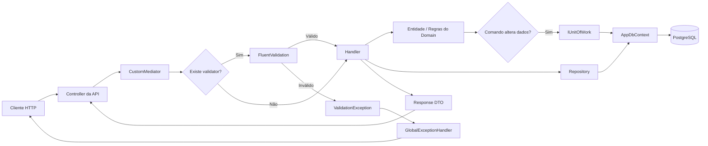

# CQRS no Memo.API

**Documentação relacionada:** [IUnitOfWork](IUNITOFWORK.md) | [Arquitetura geral](ARQUITETURA.md)

## Entendendo a ideia

CQRS significa *Command Query Responsibility Segregation*. Apesar do nome parecer complicado, a ideia é simples: separar as operações que **alteram informações** das operações que **apenas consultam informações**.

Imagine um sistema de clientes. Quando cadastramos, atualizamos ou excluímos um cliente, estamos realizando uma alteração. Essas operações são chamadas de **Commands**. Quando buscamos um cliente pelo ID ou listamos todos os clientes, estamos apenas lendo informações. Essas operações são chamadas de **Queries**.

Essa separação deixa mais claro o objetivo de cada operação e permite que cada uma tenha sua própria lógica de execução.

No Memo.API, essa separação acontece dentro do código. O projeto não utiliza bancos diferentes para leitura e escrita: tanto Commands quanto Queries trabalham com o mesmo PostgreSQL e o mesmo `AppDbContext`.

## Visão geral do fluxo

Quando uma requisição chega à API, o Controller transforma os dados recebidos em um Command ou uma Query e envia esse objeto ao `CustomMediator`. O Mediator localiza o Handler responsável e, quando existe um Validator registrado, valida os dados antes da execução. O Handler realiza o caso de uso, conversa com o domínio e utiliza o repositório para acessar os dados. Nas operações de escrita, o [`IUnitOfWork`](IUNITOFWORK.md) confirma as alterações no banco.



O fluxo é organizado em camadas. A API cuida da comunicação HTTP, a Application coordena os casos de uso, o Domain concentra as entidades e regras de negócio, e a Infrastructure implementa o acesso ao banco. Assim, a lógica da aplicação não precisa conhecer detalhes do ASP.NET ou do Entity Framework.

## Como o CQRS foi organizado no projeto

Cada operação é representada por um objeto próprio. Por exemplo, `CreateCustomerCommand` representa a intenção de cadastrar um cliente, enquanto `GetCustomerByIdQuery` representa a intenção de consultar um cliente.

Esses objetos implementam `IRequest<TResponse>`. O tipo genérico indica qual será o retorno da operação:

```csharp
public sealed record CreateCustomerCommand(
    string Name,
    AddressInput Address) : IRequest<Guid>;

public sealed record GetCustomerByIdQuery(
    Guid Id) : IRequest<CustomerResponse>;
```

No primeiro exemplo, o cadastro retorna um `Guid`, que representa o ID criado. No segundo, a consulta retorna um `CustomerResponse`, que contém os dados que a API precisa apresentar.

Cada Request possui um Handler correspondente. É nele que a operação realmente acontece. O contrato utilizado pelos Handlers é:

```csharp
public interface IRequestHandler<in TRequest, TResponse>
    where TRequest : IRequest<TResponse>
{
    Task<TResponse> HandleAsync(
        TRequest request,
        CancellationToken ct);
}
```

A restrição `where TRequest : IRequest<TResponse>` garante que o Handler receba um Request compatível com o tipo de resposta declarado. Dessa forma, um Handler de criação que retorna `Guid`, por exemplo, não pode ser associado por engano a uma operação que declara outro retorno.

O Controller não precisa conhecer o Handler. Ele apenas envia o Request ao Mediator:

```csharp
Guid id = await mediator.SendAsync(command, ct);
```

O `CustomMediator` procura o Handler correspondente usando o container de injeção de dependências. No Memo.API, ele também procura um Validator para aquele Request. Se houver um Validator registrado, a validação é executada antes do Handler. Caso os dados sejam inválidos, uma `ValidationException` é lançada e o Handler não é executado.

O Mediator mantém em cache os executores que constrói para cada combinação de Request e resposta. Esse cache evita reconstruir a mesma estrutura de execução, mas não armazena o resultado das operações: cada chamada continua executando o Handler novamente.

## Commands: quando precisamos alterar dados

Um Command representa uma intenção de escrita, como criar, atualizar ou excluir um cliente. Seu Handler coordena as etapas necessárias para realizar essa alteração.

Veja uma versão simplificada do cadastro:

```csharp
internal sealed class CreateCustomerCommandHandler(
    ICustomerRepository repository,
    IUnitOfWork unitOfWork)
    : IRequestHandler<CreateCustomerCommand, Guid>
{
    public async Task<Guid> HandleAsync(
        CreateCustomerCommand request,
        CancellationToken ct)
    {
        Address address = AddressMapper.ToDomain(request.Address);
        Customer customer = new Customer(request.Name, address);

        repository.Add(customer);
        await unitOfWork.SaveChangesAsync(ct);

        return customer.Id;
    }
}
```

Primeiro, o Handler converte o `AddressInput`, que é um modelo de entrada da Application, em um `Address`, que pertence ao Domain. Em seguida, cria a entidade `Customer` e pede ao repositório que registre essa entidade no contexto do Entity Framework. Por fim, chama `SaveChangesAsync` por meio do `IUnitOfWork` para confirmar a gravação no banco e retorna o ID do cliente.

O repositório não precisa gravar imediatamente no PostgreSQL. Métodos como `Add`, `Update` e `Delete` alteram o estado acompanhado pelo `AppDbContext`. A gravação efetiva acontece quando o [`IUnitOfWork`](IUNITOFWORK.md) chama `SaveChangesAsync`.

Antes da execução do Handler, o FluentValidation pode verificar os dados recebidos. No cadastro de cliente, por exemplo, o Validator verifica se o nome foi informado e se o CEP possui o formato esperado. Essa validação protege o caso de uso contra entradas inadequadas.

As entidades do Domain também possuem suas próprias regras. Isso é importante porque a regra de negócio não deve depender exclusivamente da validação da API. O Validator verifica os dados de entrada; a entidade protege as condições que precisam ser verdadeiras para o objeto existir ou ser alterado corretamente.

Na atualização, o Handler normalmente busca o cliente pelo ID, verifica se ele existe, converte os dados recebidos, chama o método `Update` da entidade e confirma a alteração com o `IUnitOfWork`. Se o cliente não for encontrado, é lançada uma `EntityNotFoundException<Customer>`.

A exclusão segue uma particularidade do projeto: ela é lógica (*soft-delete*), não física. Quando o repositório chama `Remove`, o `AppDbContext` intercepta a operação durante o `SaveChangesAsync` e transforma a exclusão em uma atualização. O registro permanece no banco, mas recebe `IsDeleted = true`, a data da exclusão e o usuário responsável. Um filtro global faz com que consultas normais não retornem registros excluídos.

## Queries: quando precisamos consultar dados

Uma Query representa uma operação de leitura. Ela recebe os parâmetros necessários, consulta o repositório e devolve os dados no formato esperado. Diferentemente de um Command, uma Query não deve alterar o estado do sistema e, por isso, não chama `IUnitOfWork.SaveChangesAsync`.

Um exemplo é a consulta de cliente pelo ID:

```csharp
public sealed record GetCustomerByIdQuery(
    Guid Id) : IRequest<CustomerResponse>;
```

O Handler procura o cliente no repositório. Se não encontrar o registro, lança `EntityNotFoundException<Customer>`. Se encontrar, converte a entidade em `CustomerResponse` e devolve o resultado. A API recebe um objeto de resposta, em vez de expor diretamente a entidade do Domain.

O projeto também possui Queries paginadas. Uma consulta como `GetAllCustomersQuery` recebe o número da página e a quantidade de itens por página. O repositório busca somente os registros daquela página, e o Handler converte os clientes em objetos `CustomerResponse`.

O resultado mantém os dados da paginação, como `Items`, `Page`, `PageSize`, `TotalItems` e `TotalPages`. Assim, além dos clientes encontrados, a API informa em qual página o usuário está e quantos registros existem no total.

Nas listagens, o repositório utiliza `AsNoTracking()`. Isso informa ao Entity Framework que os objetos consultados não precisam ser acompanhados pelo mecanismo de rastreamento de alterações, reduzindo o trabalho do `ChangeTracker` em operações de leitura.

## O papel de cada parte

No Memo.API, cada componente participa de uma parte específica do fluxo. O **Controller** recebe a requisição HTTP, cria ou recebe o Request, envia ao Mediator e transforma o resultado em uma resposta HTTP. Ele não deve concentrar regras de negócio nem acessar diretamente o banco.

O **CustomMediator** recebe o Request, executa o Validator quando houver um registrado e localiza o Handler correspondente. O **Validator** verifica se os dados de entrada atendem às condições esperadas. O **Handler** coordena o caso de uso: em um Command, organiza a alteração; em uma Query, organiza a consulta.

O **Domain** contém as entidades e as regras que protegem o estado do negócio. Os contratos dos repositórios e do `IUnitOfWork` também ficam definidos nessa parte da aplicação. A **Infrastructure** implementa esses contratos usando o `AppDbContext`, o Entity Framework Core e o PostgreSQL.

O `IUnitOfWork` é utilizado nas operações de escrita para confirmar as alterações. Já o repositório encapsula o acesso aos dados, evitando que os Handlers precisem conhecer diretamente o Entity Framework.

O `CancellationToken` recebido pelo Controller também é encaminhado pelo Mediator, Validator, Handler e repositório até as operações assíncronas do Entity Framework. Se a requisição for cancelada, as operações que recebem esse token podem interromper o trabalho que não é mais necessário.

Quando ocorre uma exceção, o `GlobalExceptionHandler` centraliza sua conversão em uma resposta HTTP. Por exemplo, erros de validação são respondidos com `400 Bad Request`, entidades não encontradas com `404 Not Found`, violações de regra de domínio com `422 Unprocessable Entity` e conflitos de unicidade do PostgreSQL com `409 Conflict`. Erros inesperados resultam em `500 Internal Server Error`.

## O que é importante entender sobre o CQRS do Memo.API

A separação do CQRS neste projeto é feita no código: Commands e Queries possuem Requests e Handlers diferentes, com responsabilidades distintas. Porém, eles compartilham os mesmos repositórios, o mesmo `AppDbContext` e o mesmo banco PostgreSQL. Portanto, não existem bancos separados para leitura e escrita.

Essa distinção é importante: CQRS não exige obrigatoriamente dois bancos de dados. No Memo.API, ele é utilizado para organizar os casos de uso e deixar explícito quando uma operação altera informações e quando apenas consulta.

Ao criar uma nova funcionalidade, pense primeiro no objetivo da operação. Se ela alterar dados, crie um Command e seu Handler. Se apenas consultar, crie uma Query e seu Handler. Depois, implemente a validação necessária, utilize os contratos do Domain para acessar os dados e mantenha no Controller somente a responsabilidade de receber a requisição e devolver a resposta HTTP.

Em resumo: **Command altera, Query consulta, Mediator encaminha e Handler executa.** Essa é a ideia central do CQRS aplicado no Memo.API.
