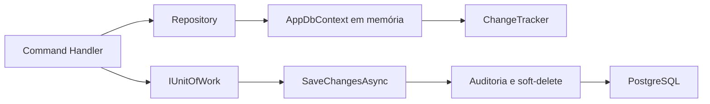

# IUnitOfWork no Memo.API

## Entendendo a ideia

O `IUnitOfWork` é utilizado para confirmar no banco de dados as alterações que a aplicação preparou. Em vez de gravar cada mudança imediatamente, o sistema registra as alterações no `AppDbContext` e, quando o caso de uso está pronto, chama `SaveChangesAsync` para persistir tudo.

No Memo.API, o `IUnitOfWork` é utilizado principalmente pelos **Commands do CQRS**, porque são eles que criam, atualizam ou excluem dados. As **Queries** apenas consultam informações e, por isso, não precisam chamar `SaveChangesAsync`.

## Visão geral do fluxo

Quando um Command precisa alterar uma entidade, o Handler utiliza o repositório para registrar a alteração no `AppDbContext`. O Entity Framework acompanha essa mudança no `ChangeTracker`. Depois, o Handler chama o `IUnitOfWork`, que solicita ao contexto que confirme as alterações. Nesse momento, o contexto também aplica as regras de auditoria e soft-delete antes de enviar os comandos ao PostgreSQL.



## Como o IUnitOfWork é implementado

O contrato `IUnitOfWork` fica no Domain:

```csharp
public interface IUnitOfWork
{
    Task<int> SaveChangesAsync(CancellationToken ct);
}
```

Essa interface define o que a aplicação precisa fazer — confirmar as alterações — sem obrigar os Handlers a conhecerem o Entity Framework.

A implementação fica na Infrastructure:

```csharp
internal sealed class UnitOfWork(AppDbContext context)
    : IUnitOfWork
{
    public Task<int> SaveChangesAsync(CancellationToken ct)
    {
        return context.SaveChangesAsync(ct);
    }
}
```

A classe `UnitOfWork` simplesmente encaminha a chamada para o `AppDbContext`. Assim, o Handler depende da abstração `IUnitOfWork`, e não diretamente da implementação técnica usada para persistir os dados.

## O que acontece antes da gravação

O `AppDbContext` acompanha as entidades por meio do `ChangeTracker`. Quando o repositório chama `Add`, `Update` ou `Remove`, o Entity Framework registra o estado da entidade, mas ainda não envia necessariamente a alteração ao banco.

| Método do repositório | Estado registrado |
|---|---|
| `Add(customer)` | `Added` |
| `Update(customer)` | `Modified` |
| `Remove(customer)` | `Deleted` |

Quando o Handler chama:

```csharp
await unitOfWork.SaveChangesAsync(ct);
```

o Entity Framework processa as alterações pendentes e retorna a quantidade de registros afetados. Nos Handlers atuais do projeto, esse número não é utilizado, mas o retorno pode ser útil para saber quantas linhas foram afetadas.

## Exemplo em um cadastro

Veja como o `IUnitOfWork` participa de um cadastro de cliente:

```csharp
repository.Add(customer);
await unitOfWork.SaveChangesAsync(ct);
return customer.Id;
```

Primeiro, o repositório registra o novo cliente no `AppDbContext`. Depois, o `IUnitOfWork` chama `SaveChangesAsync`, e o Entity Framework envia o `INSERT` ao PostgreSQL. Se a gravação for concluída, o Handler retorna o ID do cliente.

A mesma ideia vale para atualização e exclusão. Na atualização, o Handler modifica a entidade, registra a alteração no repositório e chama `SaveChangesAsync`. Na exclusão, o repositório chama `Remove`, mas o projeto transforma essa operação em **soft-delete**: em vez de apagar fisicamente o registro, o `AppDbContext` marca `IsDeleted = true` e registra a data e o usuário responsáveis pela exclusão.

## Auditoria e soft-delete

Antes de persistir as alterações, o `AppDbContext` percorre as entidades que implementam `IAuditable`. A ação depende do estado de cada entidade.

```csharp
foreach (var entry in ChangeTracker.Entries<IAuditable>())
{
    switch (entry.State)
    {
        case EntityState.Added:
            entry.Entity.WhoCreated(_userContext.Name);
            break;

        case EntityState.Modified:
            entry.Entity.UpdateAudit(_userContext.Name);
            break;

        case EntityState.Deleted:
            entry.State = EntityState.Modified;
            entry.Entity.SoftDelete(_userContext.Name);
            break;
    }
}
```

Quando uma entidade é criada, o contexto registra quem a criou. Quando é atualizada, registra a data e o usuário da atualização, preservando os dados de criação. Quando é excluída, o estado `Deleted` é convertido em `Modified`, e as informações de soft-delete são preenchidas. Por isso, o registro continua armazenado no PostgreSQL, mas deixa de aparecer nas consultas normais por causa do filtro global de exclusão lógica.

## Por que utilizar o IUnitOfWork

Sem essa abstração, um Handler poderia chamar diretamente `AppDbContext.SaveChangesAsync`. Isso faria com que a camada de aplicação dependesse do Entity Framework Core.

Com `IUnitOfWork`, o Handler conhece apenas o contrato que precisa utilizar:

```csharp
await unitOfWork.SaveChangesAsync(ct);
```

Essa organização mantém os casos de uso menos dependentes da infraestrutura e facilita testar os Handlers, pois o `IUnitOfWork` pode ser substituído por uma implementação simulada.

O repositório e o Unit of Work têm papéis diferentes: o **repositório** localiza entidades e registra o que deve ser feito com elas; o **Unit of Work** confirma as alterações pendentes no contexto.

## Como isso se relaciona com transações

O `IUnitOfWork` do Memo.API possui somente o método `SaveChangesAsync`. Ele não oferece métodos próprios como `Begin`, `Commit` ou `Rollback`, e os Handlers não criam manualmente uma transação para cada operação.

Uma chamada a `SaveChangesAsync` pode persistir várias alterações pendentes em uma única execução. O Entity Framework Core gerencia a gravação dessa chamada. Se a aplicação precisar agrupar operações separadas em uma única transação, será necessário ampliar o contrato e sua implementação; esse não é o fluxo atual dos Handlers.

## Registro e ciclo de vida

Na Infrastructure, o serviço é registrado no container de dependências:

```csharp
services.AddScoped<IUnitOfWork, UnitOfWork>();
services.AddScoped<ICustomerRepository, CustomerRepository>();
```

O `AppDbContext` também é registrado com ciclo de vida `Scoped`. Assim, durante uma mesma requisição HTTP, o repositório e o `UnitOfWork` utilizam a mesma instância do contexto. Isso é importante porque o repositório registra as alterações nesse contexto, e o Unit of Work confirma justamente as alterações que estão pendentes nele.

Ao final da requisição, o container descarta o contexto.

## CancellationToken e erros

O `CancellationToken` recebido pelo Controller é encaminhado até o Handler e passado ao `SaveChangesAsync`:

```csharp
await unitOfWork.SaveChangesAsync(ct);
```

Se a requisição for cancelada, a operação assíncrona pode ser interrompida. Se o banco rejeitar uma alteração, o `SaveChangesAsync` pode lançar uma exceção. No projeto, o `GlobalExceptionHandler` converte erros conhecidos, como violações de unicidade, em respostas HTTP apropriadas; erros inesperados são tratados como `500 Internal Server Error`.

## Quando utilizar o IUnitOfWork

Utilize `IUnitOfWork.SaveChangesAsync` quando o caso de uso criar, atualizar ou excluir uma entidade, ou quando precisar confirmar várias alterações pendentes juntas. Não o utilize em operações que apenas consultam dados, montam listas, calculam páginas ou transformam entidades em objetos de resposta.

Essa é a mesma separação aplicada pelo CQRS no Memo.API: **Commands podem alterar dados e chamam o Unit of Work; Queries apenas consultam e não chamam `SaveChangesAsync`.**

## Resumo

No Memo.API, o `IUnitOfWork` é a abstração responsável por solicitar a gravação das alterações que já foram registradas no `AppDbContext`.

Em termos simples: o repositório prepara as alterações, o `AppDbContext` acompanha o estado das entidades, o `IUnitOfWork` chama `SaveChangesAsync`, o Entity Framework aplica auditoria e soft-delete e, por fim, o PostgreSQL grava os dados.

Para entender como o Unit of Work participa da separação entre escrita e leitura, consulte a documentação de [CQRS](CQRS.md). Para conhecer a organização geral das camadas, consulte [Arquitetura](ARQUITETURA.md).
