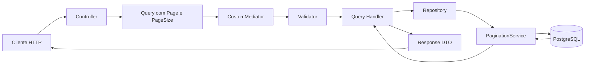

# Paginação no Memo.API

## Visão geral

O Memo.API utiliza paginação baseada em página e tamanho de página para listar
clientes, empresas e vendedores. A paginação acontece no banco de dados por
meio do Entity Framework Core: a aplicação não carrega todos os registros para
depois selecionar uma parte em memória.

O fluxo geral é:



As Queries paginadas são operações de leitura. Por isso, elas não utilizam
`IUnitOfWork` nem chamam `SaveChangesAsync`.

## Endpoints

Cada endpoint recebe os parâmetros pela query string:

| Recurso | Endpoint |
|---|---|
| Clientes | `GET /api/customers` |

Os parâmetros disponíveis são:

| Parâmetro | Padrão | Regra |
|---|---:|---|
| `page` | `1` | Deve ser maior que zero |
| `pageSize` | `10` | Deve estar entre `10` e `100` |

Exemplo:

```http
GET /api/customers?page=2&pageSize=20
```

Quando os parâmetros não são enviados, o Controller cria a Query com
`page = 1` e `pageSize = 10`:

```csharp
public async Task<IActionResult> GetAll(
    [FromQuery] int page = 1,
    [FromQuery] int pageSize = 10,
    CancellationToken ct = default)
{
    var result = await mediator.SendAsync(
        new GetAllCustomersQuery(page, pageSize),
        ct);

    return Ok(result);
}
```

Os Controllers de empresas e vendedores seguem o mesmo padrão.

## Validação dos parâmetros

Depois que o Controller cria a Query, o `CustomMediator` localiza o Handler e
executa o Validator registrado para a Query antes da consulta ao banco.

As regras são:

```csharp
RuleFor(query => query.Page)
    .GreaterThan(0);

RuleFor(query => query.PageSize)
    .InclusiveBetween(10, 100);
```

Assim:

- `page = 0` ou um valor negativo é inválido;
- `pageSize` menor que `10` é inválido;
- `pageSize` maior que `100` é inválido;
- somente valores entre `10` e `100`, inclusive, são aceitos.

Uma entrada inválida interrompe o fluxo antes do Handler e é convertida pelo
`GlobalExceptionHandler` em uma resposta de validação da API.

## Query e Handler

Cada recurso possui uma Query própria, mas todas seguem a mesma estrutura:

```csharp
public sealed record GetAllCustomersQuery(
    int Page,
    int PageSize) : IRequest<PagedList<CustomerResponse>>;
```

O Handler encaminha os parâmetros ao repositório, recebe uma `PagedList` com
entidades do Domain, converte cada item para o DTO de resposta e recria a
`PagedList` com os mesmos metadados:

```csharp
PagedList<Customer> pagedList =
    await repository.GetPagedAsync(request.Page, request.PageSize, ct);

IReadOnlyList<CustomerResponse> customers = pagedList.Items
    .Select(CustomerResponseMapper.ToResponse)
    .ToList();

return new PagedList<CustomerResponse>(
    customers,
    pagedList.Page,
    pagedList.PageSize,
    pagedList.TotalItems);
```

O Handler não calcula índices nem executa `Skip` e `Take`. Essa
responsabilidade fica concentrada na infraestrutura.

## Repositório e ordenação

O contrato do repositório recebe a página, o tamanho da página e o token de
cancelamento:

```csharp
Task<PagedList<Customer>> GetPagedAsync(
    int page,
    int pageSize,
    CancellationToken ct);
```

Antes de delegar a paginação, cada repositório prepara uma consulta
`IQueryable`:

```csharp
IQueryable<Customer> query = context.Customers
    .AsNoTracking()
    .OrderBy(customer => customer.CreatedAt)
    .ThenBy(customer => customer.Id);
```

O `AsNoTracking()` é apropriado porque a consulta não altera as entidades.
Além disso, todos os repositórios ordenam por `CreatedAt` e usam `Id` como
desempate. Essa ordenação determinística evita que um registro mude de página
apenas porque o banco retornou registros empatados em uma ordem diferente.

Clientes, empresas e vendedores utilizam a mesma estratégia:

```text
CustomerRepository -> IPaginationService
CompanyRepository  -> IPaginationService
SellerRepository   -> IPaginationService
```

## Serviço de paginação

O `PaginationService` é registrado como serviço `Scoped` e recebe qualquer
`IQueryable<T>`. Primeiro, conta o total de registros da consulta. Depois,
busca somente os itens da página solicitada:

```csharp
int totalItems = await query.CountAsync(ct);

List<T> items = await query
    .Skip((page - 1) * pageSize)
    .Take(pageSize)
    .ToListAsync(ct);

return new PagedList<T>(
    items,
    page,
    pageSize,
    totalItems);
```

Para a requisição `page = 3` e `pageSize = 10`:

```text
quantidade de itens ignorados = (3 - 1) * 10 = 20
itens retornados              = no máximo 10
```

O `CountAsync` e o carregamento da página são executados de forma assíncrona e
recebem o mesmo `CancellationToken` encaminhado desde o Controller. O banco
calcula o total e retorna apenas o intervalo solicitado, evitando materializar
todos os registros na aplicação.

## Filtro de registros ativos

As entidades listadas são auditáveis e possuem `IsDeleted`. O
`AppDbContext` configura um filtro global para retornar somente registros com
`IsDeleted = false`.

Como a consulta dos repositórios utiliza o `DbSet` normalmente, esse filtro é
aplicado tanto ao `CountAsync` quanto à busca dos itens. Portanto:

- `TotalItems` conta apenas registros ativos;
- itens excluídos logicamente não ocupam espaço em uma página;
- `TotalPages` também é calculado com base apenas nos registros ativos.

O soft-delete não é ignorado durante a paginação. Uma consulta só incluiria
registros excluídos se usasse explicitamente `IgnoreQueryFilters()`, o que não
faz parte do fluxo atual.

## Estrutura da resposta

`PagedList<T>` contém os itens da página e os metadados necessários para o
cliente navegar pelo resultado:

```csharp
public sealed record PagedList<T>(
    IReadOnlyList<T> Items,
    int Page,
    int PageSize,
    int TotalItems)
{
    public int TotalPages =>
        (int)Math.Ceiling(TotalItems / (double)PageSize);
}
```

Uma resposta para `page = 2`, `pageSize = 10` e `23` registros totais tem o
seguinte formato:

```json
{
  "items": [
    {
      "id": "00000000-0000-0000-0000-000000000000",
      "name": "Cliente de exemplo"
    }
  ],
  "page": 2,
  "pageSize": 10,
  "totalItems": 23,
  "totalPages": 3
}
```

O `TotalPages` usa arredondamento para cima:

```text
TotalPages = ceil(TotalItems / PageSize)
```

Exemplos:

| `TotalItems` | `PageSize` | `TotalPages` |
|---:|---:|---:|
| 23 | 10 | 3 |
| 20 | 10 | 2 |
| 0 | 10 | 0 |

Quando a página solicitada está além da última página, o fluxo não lança
exceção: `Items` fica vazio, enquanto os metadados continuam informando o
total real.

## Exemplo ponta a ponta

Para:

```http
GET /api/companies?page=2&pageSize=20
```

o fluxo é:

1. `CompaniesController` lê `page = 2` e `pageSize = 20`;
2. o Controller cria `GetAllCompaniesQuery(2, 20)`;
3. o `CustomMediator` executa `GetAllCompaniesValidator`;
4. o Handler chama `ICompanyRepository.GetPagedAsync(2, 20, ct)`;
5. o repositório cria uma consulta sem tracking, ordenada por data de criação
   e ID;
6. o `PaginationService` executa a contagem total;
7. o serviço aplica `Skip(20)` e `Take(20)` e materializa os itens;
8. o Handler converte `Company` em `CompanyResponse`;
9. o Controller retorna `200 OK` com `Items`, `Page`, `PageSize`,
   `TotalItems` e `TotalPages`.

## Testes que protegem o comportamento

Os testes do projeto verificam as partes principais do fluxo:

- os testes dos Controllers confirmam os valores padrão e o encaminhamento de
  `page` e `pageSize` ao Mediator;
- os testes dos Handlers confirmam a chamada ao repositório e a preservação
  dos metadados;
- os testes dos repositórios confirmam a quantidade de itens, o total e o
  cálculo de `TotalPages`.

Ao adicionar outro recurso paginado, mantenha o mesmo contrato:

1. criar uma Query com `Page` e `PageSize`;
2. validar `Page > 0` e `PageSize` entre `10` e `100`;
3. expor `GetPagedAsync` no repositório;
4. ordenar a consulta antes de chamar `IPaginationService`;
5. converter as entidades para o DTO sem perder os metadados;
6. cobrir Controller, Handler e repositório com testes.

