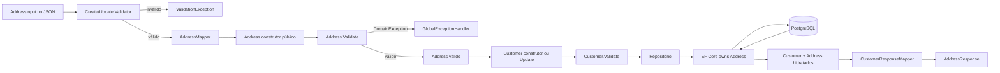

# Fluxo dos Value Objects

## Visão geral

Um Value Object representa um conceito do domínio definido pelo valor de seus
dados, e não por uma identidade própria como `Id`. No Memo.API, o Value Object
implementado atualmente é `Address`.

```text
AddressInput
  -> AddressMapper
  -> Address
  -> Customer
  -> EF Core owned entity
  -> PostgreSQL
  -> Address
  -> AddressResponse
```

`Address` está em `Memo.Domain/ValueObjects/Address.cs`. Ele representa o
endereço completo de um cliente e possui:

```text
PostalCode
Number
Street
Neighborhood
City
State
```

O endereço não possui `Id`, não possui métodos de persistência e não é
procurado por um repositório próprio. Ele é uma parte do agregado
`Customer`.

Os tipos separados usados nas outras camadas são:

| Tipo | Camada | Função |
|---|---|---|
| `AddressInput` | Application | dados recebidos em Commands HTTP |
| `Address` | Domain | conceito protegido com validações |
| `AddressResponse` | Application | dados enviados pela API |

Esta separação impede que o JSON da API seja usado diretamente como objeto de
domínio e impede que o objeto de domínio seja devolvido diretamente ao cliente.

## Por que `Address` é um record

`Address` é declarado como um record de classe:

```csharp
public sealed record Address
{
    // propriedades e construtores
}
```

O uso de `record` dá ao endereço semântica baseada em valor:

- a igualdade compara os valores das propriedades;
- objetos com os mesmos dados podem ser considerados iguais;
- o tipo é `sealed`, portanto não pode ser herdado.

Isso é diferente de `Customer`, que é uma entidade com identidade própria:

```csharp
Customer customer1 = new(...);
Customer customer2 = new(...);
```

Para saber se dois clientes são iguais, a identidade é definida pelo `Id`.
Para saber se dois endereços são iguais, os valores dos seis campos são usados
pela implementação gerada pelo record.

## Contrato da propriedade

Todas as propriedades são somente leitura externamente:

```csharp
public string PostalCode { get; private set; } = null!;
public string Number { get; private set; } = null!;
public string Street { get; private set; } = null!;
public string Neighborhood { get; private set; } = null!;
public string City { get; private set; } = null!;
public BrazilianState State { get; private set; }
```

Os setters possuem `private`, por isso código externo não pode alterá-los
isoladamente:

```csharp
address.City = "Curitiba"; // não é permitido
```

Em vez disso, o endereço só pode receber dados pelo construtor público.
Sendo um record, ele representa uma unidade que não é modificada por métodos
na entidade dona.

O uso de `null!` em propriedades `string` evita o aviso de nulabilidade antes
que o construtor inicialize o valor. O construtor é o ponto que garante a
valididade antes das propriedades serem atribuídas.

## Construtor público

O construtor recebe todos os dados necessários:

```csharp
public Address(
    string postalCode,
    string number,
    string street,
    string neighborhood,
    string city,
    BrazilianState state)
{
    Validate(
        postalCode,
        number,
        street,
        neighborhood,
        city,
        state);

    PostalCode = postalCode;
    Number = number;
    Street = street;
    Neighborhood = neighborhood;
    City = city;
    State = state;
}
```

A ordem das operações é importante:

1. `Validate` verifica todos os dados;
2. a validação lança uma exceção em caso de dado inválido;
3. somente quando todas as validações passam, os setters privados são usados;
4. um objeto parcialmente criado não pode ser retornado pelo construtor.

Essa ordem cria o invariante do Value Object: não existe instância criada pelo
construtor público com campos obrigatórios vazios ou com estado inválido.

`Address` ainda possui um construtor privado sem parâmetros:

```csharp
private Address() { }
```

Ele não é utilizado pelo código da aplicação. O Entity Framework Core precisa
de uma maneira de materializar o objeto ao ler o banco. Esse construtor permite
que o EF Core restaure o Value Object sem passar pelos dados públicos durante a
hidratação.

As propriedades continuam com setters privados para não permitir alterações
externas. O EF Core consegue mapear esses membros por configuração.

## Validação interna

O método `Validate` recebe os mesmos seis dados que o construtor:

```csharp
private static void Validate(
    string postalCode,
    string number,
    string street,
    string neighborhood,
    string city,
    BrazilianState state)
```

Ele é `private static` porque não depende do estado atual da instância.
Executa todas as verificações antes que o objeto exista.

### CEP

```csharp
if (string.IsNullOrWhiteSpace(postalCode))
    throw new DomainException(
        "Postal code cannot be null or empty.");
```

`postalCode` não pode ser `null`, vazio ou composto apenas por espaços.
Aqui o Value Object não verifica o tamanho nem se existem oito dígitos.
Essa parte está no Validator da Application.

### Número

```csharp
if (string.IsNullOrWhiteSpace(number))
    throw new DomainException(
        "Address number cannot be null or empty.");
```

Verifica somente o preenchimento obrigatório. O limite de 20 caracteres é
validado pela fronteira HTTP e pela configuração de persistência.

### Rua

```csharp
if (string.IsNullOrWhiteSpace(street))
    throw new DomainException(
        "Street cannot be null or empty.");
```

### Bairro

```csharp
if (string.IsNullOrWhiteSpace(neighborhood))
    throw new DomainException(
        "Neighborhood cannot be null or empty.");
```

### Cidade

```csharp
if (string.IsNullOrWhiteSpace(city))
    throw new DomainException(
        "City cannot be null or empty.");
```

### Estado

```csharp
if (!Enum.IsDefined(state))
    throw new DomainException("State is invalid.");
```

`BrazilianState` é um enum:

```csharp
public enum BrazilianState
{
    AC, AL, AP, AM, BA, CE, DF, ES, GO,
    MA, MT, MS, MG, PA, PB, PE, PI,
    RJ, RN, RS, RO, RR, SC, SE, SP, TO
}
```

`Enum.IsDefined(state)` evita que o objeto receba um valor numérico não
definido no enum. Por exemplo:

```csharp
(BrazilianState)999
```

não será aceito como estado.

### Exceção lançada

Todas as validações que falham usam `DomainException`:

```csharp
throw new DomainException("Postal code cannot be null or empty.");
```

Essa exceção pertence ao Domain. Ela sobe até o `GlobalExceptionHandler`, que
converte uma `DomainException` em HTTP `422 Unprocessable Entity`.

Portanto, o Value Object não depende do ASP.NET nem de código HTTP. Ele lança
uma exceção do próprio domínio e deixa que uma camada externa decida como
expor o problema.

## Validação na fronteira HTTP

Antes de construir `Address`, os Commands são validados pelo FluentValidation.
Create e Update possuem regras semelhantes em:

```text
Memo.Application/Features/Customers/Commands/Create/CreateCustomerValidator.cs
Memo.Application/Features/Customers/Commands/Update/UpdateCustomerValidator.cs
```

As regras do endereço são:

```csharp
RuleFor(customer => customer.Address)
    .NotEmpty();

RuleFor(customer => customer.Address.PostalCode)
    .NotEmpty()
    .Must(pc => pc.Length == 8 && pc.All(char.IsDigit));

RuleFor(customer => customer.Address.Number)
    .MaximumLength(20);

RuleFor(customer => customer.Address.Street)
    .MaximumLength(150);

RuleFor(customer => customer.Address.Neighborhood)
    .MaximumLength(100);

RuleFor(customer => customer.Address.City)
    .MaximumLength(100);

RuleFor(customer => customer.Address.State)
    .IsInEnum();
```

Essas verificações estão na Application porque dizem respeito ao formato da
entrada recebida pela API:

- o CEP precisa possuir exatamente oito caracteres numéricos;
- os textos possuem limites específicos;
- o estado precisa pertencer ao enum.

O `Address` também repete algumas verificações obrigatórias. Essa redundância
é deliberada:

| Camada | Tipo de proteção |
|---|---|
| Validator | formato e limites da entrada HTTP |
| Value Object | invariantes necessárias para a existência do endereço |

Um código que tenta construir `Address` diretamente recebe a proteção do
domínio. Um código que tenta enviar `AddressInput` pela API recebe validação
antes do Handler.

## `AddressInput`

O tipo usado na entrada é:

```csharp
public sealed record AddressInput(
    string PostalCode,
    string Number,
    string Street,
    string Neighborhood,
    string City,
    BrazilianState State);
```

Ele pertence à Application e é usado pelos dois Commands:

```csharp
CreateCustomerCommand(
    string Name,
    AddressInput Address)
```

e:

```csharp
UpdateCustomerCommand(
    Guid Id,
    string Name,
    AddressInput Address)
```

`AddressInput` é um contrato de transporte. Ele não valida nem cria um
`Address`. É apenas o formato recebido pelo JSON e representado em memória
pela Application.

## Mapeamento da entrada para o domínio

O método responsável pela conversão é `AddressMapper`:

```csharp
internal sealed class AddressMapper
{
    public static Address ToDomain(AddressInput input)
    {
        return new Address(
            input.PostalCode,
            input.Number,
            input.Street,
            input.Neighborhood,
            input.City,
            input.State);
    }
}
```

O mapeador somente copia os dados de uma representação para outra.

O ponto principal é `new Address(...)`: o construtor executa `Validate` e cria
a instância protegida do domínio. O método não retorna o `AddressInput`, não
retorna entidades EF e não altera o `Address` recebido.

## Fluxo na criação

No `CreateCustomerCommandHandler`, o endereço é criado assim:

```csharp
Address address = AddressMapper.ToDomain(request.Address);
Customer customer = new Customer(request.Name, address);

repository.Add(customer);
await unitOfWork.SaveChangesAsync(ct);
```

O fluxo completo é:

1. o Mediator recebe `CreateCustomerCommand`;
2. `CreateCustomerValidator` valida os dados de entrada;
3. se válido, o Handler chama `AddressMapper.ToDomain`;
4. `AddressMapper` passa os dados ao construtor de `Address`;
5. `Address.Validate` protege o valor;
6. o objeto `Address` é passado ao construtor de `Customer`;
7. `Customer.Validate` protege o nome e confirma que o endereço não é `null`;
8. o `Customer` recebe o endereço;
9. o repositório registra o agregado no `AppDbContext`;
10. o Unit of Work confirma as alterações no PostgreSQL.

O endereço não é salvo por uma tabela separada. Ele é configurado como parte
owned do `Customer`.

## Fluxo na atualização

No `UpdateCustomerCommandHandler`, o Handler primeiro busca o cliente:

```csharp
Customer? customer =
    await repository.GetByIdAsync(request.Id, ct);

if (customer is null)
    throw new EntityNotFoundException<Customer>();
```

Somente depois cria o novo endereço:

```csharp
Address address = AddressMapper.ToDomain(request.Address);
customer.Update(request.Name, address);
```

O método `Update` da entidade executa novamente a validação:

```csharp
public void Update(string name, Address address)
{
    Validate(name, address);
    Name = name;
    Address = address;
}
```

O endereço não é alterado campo por campo. A entidade substitui o Value Object
inteiro por outra instância de `Address`, e o EF Core passa a persistir os
dados dessa nova instância.

Isso garante consistência: um endereço válido não fica parcialmente atualizado
durante o método. O novo objeto só é atribuído depois de passar pelas
validações.

## Proteção feita pela entidade

`Customer.Validate` protege tanto o nome quanto o objeto de endereço:

```csharp
private static void Validate(string name, Address address)
{
    if (string.IsNullOrWhiteSpace(name))
        throw new DomainException(
            "Customer name cannot be null or empty.");

    if (address is null)
        throw new DomainException(
            "Address cannot be null or empty.");
}
```

Essa proteção evita que uma entidade seja criada ou alterada sem endereço.
Ela é necessária mesmo porque o construtor de `Address` já valida seus campos,
pois a entidade pode receber `null` para o endereço inteiro.

Criar com endereço válido:

```csharp
Address address = new(...);
Customer customer = new("Cliente", address);
```

Tentar criar sem endereço:

```csharp
Customer customer = new("Cliente", null!);
```

lança `DomainException` antes de atribuir o estado da entidade.

## Configuração no Entity Framework

No `CustomerConfiguration`, o endereço é configurado como owned type:

```csharp
builder.OwnsOne(customer => customer.Address, address =>
{
    address.Property(value => value.PostalCode)
        .HasColumnName("PostalCode")
        .HasMaxLength(8)
        .IsRequired();

    address.Property(value => value.Number)
        .HasColumnName("AddressNumber")
        .HasMaxLength(20)
        .IsRequired();

    address.Property(value => value.Street)
        .HasColumnName("Street")
        .HasMaxLength(150)
        .IsRequired();

    address.Property(value => value.Neighborhood)
        .HasColumnName("Neighborhood")
        .HasMaxLength(100)
        .IsRequired();

    address.Property(value => value.City)
        .HasColumnName("City")
        .HasMaxLength(100)
        .IsRequired();

    address.Property(value => value.State)
        .HasConversion<string>()
        .HasColumnName("State")
        .HasMaxLength(2)
        .IsRequired();
});
```

`OwnsOne` significa que o endereço não possui uma entidade principal separada
com `CustomerAddressId`. Os campos são armazenados na mesma tabela
`Customers`, como colunas:

```text
PostalCode
AddressNumber
Street
Neighborhood
City
State
```

`State` usa conversão para `string`. Assim, `BrazilianState.SP` é armazenado
como `"SP"` e restaurado como o mesmo membro do enum.

As configurações de tamanho e obrigatoriedade reforçam no banco as mesmas
limitações usadas pela API:

| Coluna | Máximo |
|---|---:|
| `PostalCode` | 8 |
| `AddressNumber` | 20 |
| `Street` | 150 |
| `Neighborhood` | 100 |
| `City` | 100 |
| `State` | 2 |

O índice exclusivo do nome do cliente também está configurado no
`CustomerConfiguration`, mas não faz parte da validação do `Address`.

## Materialização pelo EF Core

Ao consultar um cliente, o EF Core precisa reconstruir:

```text
Customer
└── Address
```

O construtor privado de `Address` ajuda o EF Core a materializar o objeto sem
usar o construtor público da aplicação. Em seguida, o provider atribui os
dados às propriedades privadas ou aos campos conhecidos pela configuração.

Esse é um dos motivos pelos quais o Value Object não deve conter lógica
dependente de banco. A aplicação cria o objeto pelo construtor público, e o EF
Core o restaura pela configuração owned.

## Mapeamento para a resposta

Quando uma Query busca um cliente, `CustomerResponseMapper` transforma o
endereço de domínio em um DTO:

```csharp
public static AddressResponse ToResponse(Address address)
{
    return new AddressResponse(
        address.PostalCode,
        address.Number,
        address.Street,
        address.Neighborhood,
        address.City,
        address.State);
}
```

O endereço de saída é outro record:

```csharp
public sealed record AddressResponse(
    string PostalCode,
    string Number,
    string Street,
    string Neighborhood,
    string City,
    BrazilianState State);
```

`AddressResponse` não usa `Address` diretamente para impedir que o domínio
tenha setters ou comportamentos acidentalmente serializados pela API.

A conversão completa é:

```csharp
public static CustomerResponse ToResponse(Customer customer)
{
    return new CustomerResponse(
        customer.Id,
        customer.Name,
        ToResponse(customer.Address));
}
```

O JSON resultante possui o endereço como objeto aninhado:

```json
{
  "id": "00000000-0000-0000-0000-000000000000",
  "name": "Cliente",
  "address": {
    "postalCode": "01001000",
    "number": "100",
    "street": "Rua Principal",
    "neighborhood": "Centro",
    "city": "São Paulo",
    "state": "SP"
  }
}
```

## Igualdade por valor

Como `Address` é um record, o compilador gera:

- `Equals(Address?)`;
- `Equals(object?)`;
- `GetHashCode()`;
- operadores `==` e `!=`.

A igualdade usa os valores das propriedades. Por exemplo:

```csharp
Address first = new(..., BrazilianState.SP);
Address second = new(..., BrazilianState.SP);

bool equal = first == second;
```

Nessa situação, `equal` é `true` se todos os dados forem iguais, mesmo que
sejam instâncias diferentes.

Esse comportamento ajuda a representar um Value Object: o endereço não é
identificado por uma referência ou por um `AddressId`, mas pelo conjunto dos
dados que o compõe.

## Fluxo ponta a ponta



As proteções têm responsabilidades diferentes:

```text
Create/UpdateValidator
  valida entrada da API

Address.Validate
  protege o valor de Address

Customer.Validate
  protege a entidade que contém o Address

CustomerConfiguration
  protege limites e obrigatoriedade no banco

GlobalExceptionHandler
  transforma DomainException em resposta HTTP
```

## Como o Value Object é testado

Os testes não possuem atualmente uma classe dedicada a `Address`. A proteção
dele aparece nos testes de `Customer`, como em
`Memo.Domain.Tests/Entities/CustomerTests.cs`.

Esses testes verificam:

- criação de `Customer` com endereço válido;
- `PostalCode`, cidade e demais dados disponíveis na entidade;
- substituição do endereço no método `Update`;
- exceções para nome inválido;
- propriedades de auditoria e soft-delete.

Os testes de repositório também criam endereços válidos e verificam criação,
consulta e atualização no banco.

Ao adicionar validações específicas ao `Address`, o ideal é cobrir pelo menos:

1. cada campo obrigatório vazio;
2. enum com valor não definido;
3. criação válida;
4. igualdade entre dois objetos com os mesmos dados;
5. atualização substituindo o objeto inteiro;
6. persistência e restauração do endereço pelo EF Core.

